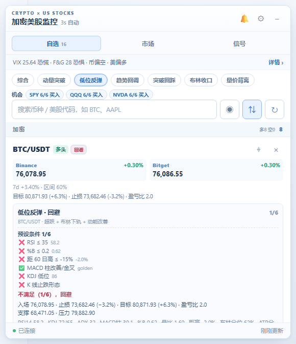

# 加密美股监控 · Crypto × US Stock Monitor

DSH Desktop 左下角的加密 + 美股行情监控面板（v0.12.2，宽 560px）：自选行情、技术面、市场宽度、VIX/VXN/F&G 情绪与信号提醒。

> **免责声明**
> 本项目仅用于行情监控与技术分析学习，**不是投资建议**，不承诺任何收益。面板里的「买入/关注/等待/回避」是规则化条件判断，不是荐股；历史回测显示「综合」预设长期跑输买入持有（见文末「回测说明」）。数据来自第三方公共接口，可能延迟、缺失或中断；据此交易的风险由使用者自行承担。
>
> 本项目与 Binance、Bitget、Yahoo、OKX、Alternative.me 均无关联，也未获得其背书；相关名称仅用于说明数据来源。



## 安装与兼容

- 需要 **DSH Desktop**（支持 Cordis 插件 / `dsh.bundle.patch`），**不是独立网页应用**，不能直接 `npm start`。
- 本仓库无构建步骤、无第三方运行时依赖；`package.json` 的 `dsh.bundle.patch` 指向 `cordis.patch.yml`。
- 将仓库放到本地任意目录，通过 DSH 的插件管理或配置以本地 `link` 方式加载；重启 DSH Desktop 后，左下角出现「加密美股监控」。
- 已在 Windows + DSH Desktop 上验证；Host/Client 插件 API 可能随 DSH 版本变化，升级 DSH 后请重新跑一次自检。
- 技术包名/id 仍为 `dsh-binance-bitget-watchlist`，用于兼容旧安装与路由；公开显示名是「加密美股监控」。

## 隐私

- 不需要 API Key；不收集、不上传自选列表或使用数据。
- 自选、预设、提醒、目标价只存在浏览器 `localStorage`。
- 行情请求由本机直接发往 Binance / Bitget / Yahoo / OKX / Alternative.me 的公共接口，受各站条款与速率限制约束。

## 回测说明（重要）

2026-11 对「综合」预设做过一次 10 年日线回测（2016-11 → 2026-11，次日开盘、0.1%/边、2×ATR 止损 / 3×ATR 目标 / 60 日上限、评分 <40% 离场）：

| 标的 | 策略年化 | 买入持有年化 |
|---|---:|---:|
| SPY | 7.7% | 15.0% |
| QQQ | 11.3% | 19.7% |
| NVDA | 20.5% | 59.6% |
| BTC | 6.6% | 59.6% |
| ETH | 11.3% | 24.1% |

结论：它是**降低波动的时间过滤**，不是长期 alpha；不要把它当独立全仓策略。回测有幸存者偏差、未计滑点/税，样本仅 5 个近期强势标的。

## 仪表盘怎么读（新增 0.8.0）

- 只读公共行情，不需要 API Key。
- 加密行情双源：Binance 24h ticker + Bitget v3 SPOT ticker；任一源失败不影响另一源。
- 全市场宽度：加密（Binance USDT 交易对涨跌家数/中位涨跌/成交额加权）与美股（4 大指数 + 11 个板块 ETF + VIX）。
- 情绪仪表盘：VIX（含 1 年分位）、VXN（纳斯达克 100 波动率，科技股恐慌）、Alternative.me 加密恐惧贪婪指数。
- 衍生品数据：OKX BTC 永续多空账户比、空头占比、未平仓名义价值、当前资金费率。
- **7 套可切换策略预设**：综合 / 动量突破 / 低位反弹 / 趋势回调 / 突破回踩 / 布林收口 / 量价背离；可复制、改名、改参数与阈值，保存为自定义预设。
- **自动化**：每次刷新自动扫描预设条件；新触发「买入」时写入提醒历史、响铃计数、弹 toast；可选桌面通知；「机会」栏自动列出通过率最高的 3 个标的；支持只看机会、按信号/涨跌排序、概览一键折叠成一行摘要。
- 每个标的的完整技术面板：趋势、KDJ、CCI、Williams %R、ADX/DMI、MACD（含柱变化/金叉死叉）、BOLL（含带宽分位）、ATR（分位）、量比/量能趋势、OBV 斜率、20 日突破/跌破、60 日高低距离、RSI 背离、K 线形态、均线排列/斜率。
- 每个标的给出预设条件清单（✅/❌ + 数值）、买入/关注/等待/回避、入场/止损/目标/盈亏比。

## 仪表盘怎么读（新增 0.8.0）

每个仪表不再只给数字，而是直接给「状态 + 该做什么」：

- **VIX（美股恐慌）**：`平静 · 可执行` / `正常 · 按信号` / `警惕 · 别追高` / `恐慌 · 轻仓等` / `极度恐慌 · 分批买`（阈值 15/20/25/30）。
- **VXN（科技股恐慌）**：`正常 · 按信号` / `警惕 · 别加科技` / `偏高 · 控科技仓` / `极高 · 等企稳`（阈值 18/23/28/35）。
- **加密 F&G**：`极度恐惧 · 分批` / `恐惧 · 分批` / `中性 · 持有` / `贪婪 · 别追高` / `过热 · 减仓`（0–25/26–45/46–55/56–75/76–100）。

仪表下方新增 **「现在该做什么」** 建议条，把三项合成一句话，例如：

> VIX 26 恐慌：轻仓观望，等回落到 20 以下再加；科技 VXN 34 偏高：科技仓位别加；加密 F&G 28 恐惧：分批

颜色越红代表风险越高；鼠标悬停可看具体数值、1 年分位和原始区间。这些是**风险提示，不是买卖建议**。

### 历史分布条

每个指标一条分布色带：**条宽 = 该区间在历史中的占比**，蓝框 = 当前区间。下面两行直接给出：

- `少见 · 21 天/年`：当前区间每年平均出现多少天；
- `常态 15–20（35.8%） · 高于 87% 的交易日`：历史最常出现的区间，以及当前值在历史样本中的分位。

当前真实数据示例：

- **VIX**：当前 25–30（8.5%，约 21 天/年，少见）；常态 15–20（35.8%，约 90 天/年）；高于 87% 的交易日。
- **VXN**：当前 28–35（14.5%，约 37 天/年，常见）；常态 18–23（33.2%，约 84 天/年）；高于 92% 的交易日。
- **加密 F&G**：当前 26–45（27.8%，约 101 天/年，常态）；常态 26–45 恐惧（27.8%）；高于 30% 的交易日。

说明：

- **关键阈值天数**：每条色带下再列 `≥20 79天 · ≥25 37天 · ≥30 15天 · ≥35 6天`，含义是「每年有多少天达到或超过该值」；F&G 同时给恐惧侧 `≤25 84天 · ≤45 186天` 与贪婪侧 `≥55 129天 · ≥75 38天`。
- **各区间明细**：点「查看各区间每年天数」展开三列，列出每个区间的 `每年天数 + 占比`，当前区间高亮。
- 「每年约 N 天」= 该区间历史天数 ÷ 样本年数，是长期平均，不是每个自然年。
- 「常态」= 历史占比最高的区间；「高于 X% 的交易日」= 当前值在样本中的历史分位。
- 频率分级：占比 ≥25% 常态、10–25% 常见、3–10% 少见、<3% 极端。
- 数据口径：VIX/VXN 用近 10 年交易日（约 2516 天），F&G 用 Alternative.me 全部历史（3199 天 / 8.8 年）；每天计一次，不按「连续段」计数。

### 界面（0.12.0 三页签）

- **自选**（默认）：顶部一行市场摘要（VIX/F&G/币/美，可点进市场），下面是预设条、机会 chips、搜索与完整自选列表；列表占据剩余全部高度。
- **市场**：VIX/VXN/F&G 仪表、操作建议、历史分布条、多空数据、加密/美股宽度卡；内容可滚动。
- **信号**：最近的买入提醒历史，可清空；铃铛与页签上的数字显示未读数。
- 搜索栏内：◉ 只看机会、⇅ 排序、↻ 刷新；齿轮打开设置（高级参数折叠）。
- 面板宽度 560px，列表行悬停高亮，长内容不挤压自选。

## 自动化与快捷操作

- **信号提醒**：每 3 秒刷新后自动用当前预设扫描全部标的；某标的从「未买入」转为「买入」（通过率 ≥80%）时记录提醒（保留最近 50 条）、铃铛计数 +1、弹 toast。同一标的 10 分钟内不重复提醒；切换预设不会静默，批量触发时合并为「N 个信号触发」。
- **桌面通知**：设置里勾选「桌面通知」并授权后，新信号同时发系统通知。
- **机会栏**：自动显示通过率 ≥60% 的前 3 个标的，点击定位并高亮对应行。
- **只看机会**：一键隐藏通过率 <60% 的标的；「排序」在默认 / 信号 / 涨跌之间循环。
- **概览折叠**：标题栏 ▾ 把仪表盘、预设、市场卡收成一行摘要（VIX/VXN/F&G/市场方向/当前预设），点击摘要恢复。
- **自动刷新**：3 秒报价、30 秒市场；页面隐藏时暂停，回到页面立即刷新。

## 接口

基址：`/plugins/dsh-binance-bitget-watchlist/api`

### GET `/quotes`

```
/quotes?symbols=BTCUSDT,ETHUSDT&stocks=SPY,QQQ&ma=5,20&malong=50&rsi=14&macd=12,26,9&boll=20,2&atr=14&adx=14&breakout=20&volp=20&th=0.2&style=balanced
```

- `symbols`：加密对，最多 30 个；`stocks`：美股代码，最多 12 个（缺省用 SPY,QQQ,DIA,IWM,NVDA,AAPL）。
- `ma=fast,slow`、`malong`（默认 50）、`rsi`（14）、`macd=fast,slow,signal`、`boll=period,mult`、`atr`（14）、`adx`（14）、`breakout`（20 日）、`volp`（20 日量能）、`th`（0.2）、`style=balanced|trend|momentum|meanrev`。
- 参数经服务端归一化，响应里 `taConfig` 回显实际生效值；`symbols` 与 `stocks` 都为空 → `400 symbols-required`。
- 最少需要 61 根日线；Binance 默认取 61 根，慢线/长线/ADX/突破周期更大时自动加量（上限 300）。

`ta` 主要字段：

```json
{
  "price": 75883.22, "bars": 61,
  "maFast": 76842.94, "maSlow": 79146.66, "maLong": 81843.94,
  "maLongSlopePct": -0.65, "priceVsMaSlowPct": -4.1, "priceVsMaLongPct": -7.3,
  "maAlignment": "bear",
  "rsi": 35.8, "kdj": { "k": 20.1, "d": 23.5, "j": 13.3 },
  "cci": -88.2, "williamsR": -71.3,
  "adx": { "adx": 18.4, "plusDi": 12.2, "minusDi": 24.6 },
  "macd": { "line": -120.4, "signal": -90.2, "hist": -30.2, "prevHist": -25.0 },
  "macdCross": null,
  "boll": { "upper": 79100.2, "middle": 78500.1, "lower": 77900, "percentB": 0.42, "bandwidthPct": 1.5, "bandwidthPercentile": 62 },
  "atr": 1234.5, "atrPct": 2.1, "atrPercentile": 38,
  "volumeRatio": 0.21, "volumeTrend": 0.85, "obvSlopePct": -18.2,
  "breakout20": false, "breakdown20": false,
  "high60": 84898, "low60": 71626,
  "distanceHigh60Pct": -10.6, "distanceLow60Pct": 6.0,
  "rsiDivergence": "bullish", "candle": "hammer",
  "trend": { "label": "空头", "score": -0.66, "threshold": 0.2 }
}
```

客户端不再依赖服务端 `ta.signal`，而是用上述原始指标 + 本地预设规则计算信号与止盈止损，因此自定义预设可以即时生效。

### GET `/market`

```json
{
  "ok": true, "th": 0.2,
  "crypto": { "label": "震荡", "score": -0.12, "bullProbability": 43, "universe": 105, "up": 35, "down": 70, "medianChangePct": -0.29, "weightedChangePct": -0.2,
    "derivatives": { "longShortRatio": 2.98, "longPct": 74.9, "shortPct": 25.1, "openInterestUsd": 2626802942, "fundingRatePct": 0.0002 } },
  "stock": { "label": "震荡", "score": -0.05, "bullProbability": 50, "indexUp": 3, "indexCount": 4, "sectorUp": 3, "sectorCount": 11, "aboveMa20Count": 7, "aboveMa20Total": 15, "vix": { "price": 25.64 } },
  "sentiment": {
    "vix": { "price": 25.64, "percentile": 95, "zone": "恐慌" },
    "vxn": { "price": 34.02, "percentile": 99, "zone": "恐慌" },
    "cryptoFearGreed": { "value": 28, "label": "Fear", "previous": 25 }
  }
}
```

### GET `/search`

`/search?q=aapl&limit=8`：加密按相关性（精确→前缀→包含，成交额排序）；美股走 Yahoo 搜索并补价格；`q=aapl` 时股票 AAPL 排在加密 AAPLBUSDT 之前。

## 策略预设

| 预设 | 核心条件 | 风格 |
| --- | --- | --- |
| 综合 | 趋势多头、站上慢线、MACD 柱为正、RSI<70、%B<0.9 | balanced |
| 动量突破 | 多头、突破 20 日高点、量比≥阈值、ADX≥阈值、RSI 区间、贴近 60 日高 | momentum |
| 低位反弹 | RSI≤35、%B≤0.2、距 60 日高≤−15%、MACD 改善/金叉、KDJ 低位、止跌 K 线 | meanrev |
| 趋势回调 | 价格>长线、均线多头排列、ADX≥25、RSI 38–62、回踩慢线 ±3%、MACD 柱≥0 | trend |
| 突破回踩 | 价格>慢线、距高≥−3%、缩量回踩、RSI 45–70、MACD 柱≥0、守住突破位 | momentum |
| 布林收口 | 带宽分位≤20%、ATR 分位≤45%、贴近慢线、RSI 区间、方向选择在即 | balanced |
| 量价背离 | RSI 底背离、RSI≤45、距高≤−10%、脱离 60 日低点、MACD 改善、止跌 K 线 | meanrev |

- 通过率 ≥80% →「买入」；≥60% →「关注」；≥40% →「等待」；否则「回避」。
- 止损 = 现价 − 止损×ATR（默认 2×）；目标 = 现价 + 盈亏比×风险（默认 1.5×）；可在预设中改 ATR 倍数与盈亏比。
- 修改内置预设的参数/阈值会自动另存为「xxx 自定义」，不会污染内置规则；自定义预设可改名、改类型、删除。
- 以上为**规则化技术分析，不是投资建议**，不保证收益。

## 数据源

- Binance 现货：`data-api.binance.vision`（24h ticker、日线 klines）。
- Bitget：`api.bitget.com/api/v3/market/tickers`。
- Yahoo Finance：`query1.finance.yahoo.com`（chart 与 search；`^VIX`、`^VXN`、4 大指数、11 个板块 ETF）。
- OKX：BTC 永续多空账户比、未平仓、资金费率（Binance Futures 451、Bybit 403 不可用）。
- Alternative.me：加密恐惧贪婪指数（每日更新）。

## 缓存与刷新

| 数据 | TTL |
| --- | --- |
| Binance 全量 ticker（搜索/宽度） | 10 分钟 |
| Binance 指定 pair 批量报价 | 10 秒 |
| Binance 日线（TA/趋势） | 5 分钟 |
| Bitget 单 pair ticker | 10 秒 |
| Yahoo 日线（报价/TA） | 60 秒 |
| `/search` 最终响应 | 30 秒 |
| `/market` 组合结果 | 60 秒 |
| 加密恐惧贪婪 | 5 分钟 |
| OKX 衍生品 | 60 秒 |

- 相同 key 并发合并；过期先返回旧值并后台刷新；失败保留旧值但标记 `errors`。
- 单次上游 8 秒超时；并发上限 6。客户端每 3 秒（可配置 2/5/10 秒）轮询 `/quotes`，每 30 秒轮询 `/market`；页面隐藏时暂停。

## 已知限制

- Binance Futures 与 Bybit 在本机返回 451/403，多空/OI/资金费率使用 OKX；美股个股空头持仓无免 Key 实时源（Yahoo quoteSummary 401、FINRA 滞后），面板用板块/指数宽度 + VIX/VXN 表达空头压力。
- K 线形态用「前收≈开盘」的近似口径（数据源无 open），不是教科书级吞没形态。
- 61 根边界时布林带宽/ATR 分位历史不足 60 个样本；慢线 >120 时 Yahoo 改拉 1 年。
- VIX/VXN 区间为经验阈值；不提供历史 K 线下载或下单能力。
- 仅做行情与规则提示；不代下单、不接券商账户。

## English

A DSH Desktop plugin for crypto + US stock market monitoring: watchlist quotes from Binance/Bitget, Yahoo-based US indices/sectors/VIX/VXN, crypto Fear & Greed, OKX derivatives, technical indicators, configurable strategy presets, and local alerts. Requires DSH Desktop; no API keys, no telemetry, no trading execution.

**Not investment advice. Use at your own risk. Not affiliated with any data provider.**

## License

MIT — see [LICENSE](LICENSE).

